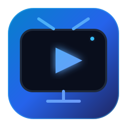

<div align="center">

  

  # FreeTV Player

  **Современный, высокоскоростной IPTV-плеер с открытым исходным кодом для Windows, Android-смартфонов и Android TV.**

  [](https://github.com/prostoy23rus/FreeTV/releases)
  [](https://github.com/prostoy23rus/FreeTV/releases)
  [](LICENSE)
  [](https://github.com/prostoy23rus/FreeTV)

  <br />

  <p>
    <a href="https://github.com/prostoy23rus/FreeTV/releases/download/v1.0.0/FreeTV.Setup.1.0.0.exe">
      
    </a>
    &nbsp;&nbsp;
    <a href="https://github.com/prostoy23rus/FreeTV/releases/download/v1.0.0/FreeTV.Android.Mobile.1.0.0.apk">
      
    </a>
    &nbsp;&nbsp;
    <a href="https://github.com/prostoy23rus/FreeTV/releases/download/v1.0.0/FreeTV.Android.TV.1.0.0.apk">
      
    </a>
  </p>

</div>

---

## 📖 О проекте

**FreeTV Player** — это универсальный медиаплеер для комфортного просмотра прямого эфира телевидения. Плеер оптимизирован под каждую платформу индивидуально:

- 📱 **FreeTV Mobile (для смартфонов)** — оптимизирован для сенсорного управления, поддерживает автоповорот (в вертикальном положении: плеер + EPG + список каналов; в горизонтальном: 100% экран под видеопоток без лишних кнопок).
- 📺 **FreeTV TV (для Android TV и ТВ-боксов)** — выделенная версия с интерфейсом для больших экранов (10-foot UI), управлением пультом ДУ, поддержкой Leanback и быстрым переключением каналов.
- 🪟 **FreeTV Windows Desktop** — настольная версия с аппаратным ускорением GPU, поддержкой PiP (картинка в картинке) и горячими клавишами.

В плеер уже предустановлен актуальный проверенный плейлист с **более чем 590 открытыми российскими телеканалами**, структурированными по понятным тематическим категориям.

---

## 🌟 Ключевые возможности

- 📺 **590+ проверенных каналов**: Эфирные, Кино и Сериалы, Познавательные, Детские, Музыка, Новости, Спорт, Региональные и Релакс.
- 📅 **Интерактивная телепрограмма (EPG)**:
  - Название текущей передачи и тайминг эфира.
  - Динамическая шкала прогресса (процент прошедшего времени передачи).
  - Подробное описание передачи и анонс следующей программы в эфире.
- ⚡ **Высокопроизводительный движок воспроизведения**:
  - Мгновенный запуск потоков HLS (`m3u8`), TS и MP4.
  - Аппаратное ускорение видеочипом устройства (GPU).
  - Автоматическое восстановление соединения при сетевых задержках.
- 🗂️ **Категории и фильтрация**:
  - Быстрое переключение между тематическими разделами.
  - Умный поиск каналов по названию и группе.
  - ⭐ **Избранное**: сохранение и удаление любимых телеканалов прямо из списка каналов.
  - 🕒 **История**: автоматическое сохранение последних воспроизведенных каналов.
- ⚙️ **Меню настроек**: счетчик каналов в реальном времени, кнопка принудительного обновления плейлиста и EPG, возможность подключить собственный M3U/M3U8 источник.

---

## 📱 Оптимизация для смартфонов (FreeTV Mobile)

- 🔄 **Умная ориентация экрана**:
  - **Вертикальное положение (портрет)**: видеоплеер 16:9 сверху, инфо-панель текущего эфира, шкала телепрограммы EPG и удобный прокручиваемый список каналов внизу.
  - **Горизонтальное положение (ландшафт)**: чистый видеопоток на 100% экрана смартфона. Все панели управления скрываются, чтобы не мешать просмотру.
- 🪟 **Безрамочный режим (Display Cutout)**: изображение адаптируется под экраны с «чёлками» и вырезами для камеры без чёрных полос по бокам.
- 🔍 **Двойной тап**: двойное нажатие по видео переключает масштаб между оригинальными пропорциями и заполнением всего экрана.
- 👆 **Сенсорные оптимизации**: крупные области нажатия на звездочку избранного (44×44 px), убраны лишние кнопки интерфейса.
- 🚪 **Удобный выход**: закрытие приложения по двойному нажатию кнопки «Назад» с системным уведомлением.

---

## 📺 Версия для Android TV и ТВ-приставок (FreeTV TV)

- 🎮 **Полноценная навигация с пульта ДУ**:
  - `Вверх` / `Вниз`: перемещение по списку каналов.
  - `Влево` / `Вправо`: свернуть или развернуть список каналов.
  - `OK` / `Enter`: выбор и запуск канала.
  - `CH+` / `CH-` (или `Page Up` / `Page Down`): мгновенное переключение каналов во время просмотра.
  - `Меню` (кнопка `Menu` или `Info` на пульте): открытие экрана настроек.
  - `Цифры 0-9`: прямой набор номера канала с экрана ТВ.
  - `Назад`: возврат или выход из приложения по двойному нажатию.
- 💡 **Высококонтрастный фокус**: крупные карточки каналов и чёткая подсветка для комфортного просмотра с расстояния в несколько метров.
- 🖼️ **Leanback Launcher**: официальный баннер для быстрого запуска с главного экрана Android TV.

---

## 🪟 Возможности для Windows Desktop

- 🗔 **Режим «Картинка в картинке» (PiP)**: смотрите любимую передачу поверх всех окон во время работы за компьютером.
- 🖥️ **Полноэкранный режим**: разворачивание по нажатию клавиши `F` или двойному клику.
- 🛡️ **Обход сетевых ограничений**: встроенная эмуляция заголовков User-Agent и Referer для стабильного воспроизведения защищённых стримов.

---

## ⌨️ Горячие клавиши и управление

| Клавиша / Кнопка | Windows Desktop | Android TV | Смартфон |
| :--- | :--- | :--- | :--- |
| `↑` / `↓` | Перемещение по каналам | Перемещение по каналам | Скролл тачем |
| `Enter` / `OK` | Включить канал | Включить канал | Тап по каналу |
| `CH+` / `CH-` | След. / пред. канал | След. / пред. канал | Свайп / клик |
| `Пробел` | Пауза / Возобновить | Пауза / Возобновить | Тап паузы |
| `F` | Полный экран | Автоматически | Автоповорот |
| `Меню` / `M` | Настройки | Меню настроек | Кнопка ⚙️ |
| `0-9` | Набор номера канала | Набор номера канала | — |
| `Escape` / `Назад` | Закрыть меню | Выход / Назад | Выход (двойной тап) |

---

## 🚀 Установка

### 📱 Android (Смартфоны):
1. Скачайте **[FreeTV.Android.Mobile.1.0.0.apk](https://github.com/prostoy23rus/FreeTV/releases/download/v1.0.0/FreeTV.Android.Mobile.1.0.0.apk)**.
2. Установите APK на смартфон и подтвердите разрешение на установку из неизвестных источников при запросе системы.
3. Откройте приложение — каналы и телепрограмма уже готовы к просмотру.

### 📺 Android TV и ТВ-боксы:
1. Скачайте **[FreeTV.Android.TV.1.0.0.apk](https://github.com/prostoy23rus/FreeTV/releases/download/v1.0.0/FreeTV.Android.TV.1.0.0.apk)** на флешку или через приложение «Send Files to TV».
2. Установите APK на телевизор или приставку.
3. Управляйте привычным пультом ДУ!

### 🪟 Windows:
1. Скачайте **[FreeTV.Setup.1.0.0.exe](https://github.com/prostoy23rus/FreeTV/releases/download/v1.0.0/FreeTV.Setup.1.0.0.exe)**.
2. Запустите инсталлятор и завершите установку в один клик.

---

## 💻 Сборка из исходного кода

### Windows (Electron):
```bash
# Клонирование репозитория
git clone https://github.com/prostoy23rus/FreeTV.git
cd FreeTV

# Установка зависимостей
npm install

# Запуск в dev-режиме
npm start

# Сборка готового инсталлятора Windows
npm run dist
```

### Android (Mobile & TV APK):
```bash
cd android
# Сборка версии для смартфонов
./gradlew assembleMobileDebug

# Сборка версии для Android TV
./gradlew assembleTvDebug
```

---

## 📄 Лицензия

Проект распространяется под свободной лицензией [MIT](LICENSE).
